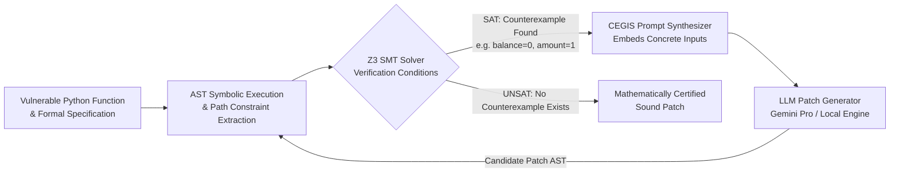

<div align="center">



<br />

[](https://github.com/acedev0/verifix/releases)
[](https://python.org)
[](https://github.com/Z3Prover/z3)
[-6366f1?style=flat-square)](./docs/ARCHITECTURE.md)
[](https://github.com/acedev0/verifix/actions)
[](./LICENSE)

<br />

<sub>
<a href="#-the-neurosymbolic-cegis-loop">CEGIS Loop</a> &nbsp;·&nbsp;
<a href="#-quickstart">Quickstart</a> &nbsp;·&nbsp;
<a href="#-cli-reference">CLI Reference</a> &nbsp;·&nbsp;
<a href="#-python-api-examples">Python API</a> &nbsp;·&nbsp;
<a href="./docs/ARCHITECTURE.md">Architecture &amp; Math</a> &nbsp;·&nbsp;
<a href="./docs/USER_GUIDE.md">User Guide</a>
</sub>

</div>

<br />

## What is VeriFix?

Generative Large Language Models write code that *looks* right to human reviewers, but frequently harbor subtle boundary conditions, off-by-one errors, division by zero, and integer overflows. 

**VeriFix** solves the code repair hallucination problem by binding generative synthesis to formal logic. It places the LLM inside a **Counterexample-Guided Inductive Synthesis (CEGIS)** loop orchestrated with the **Microsoft Z3 SMT solver**.

> [!IMPORTANT]
> **No hallucinated patches.** In VeriFix, an LLM acts strictly as a candidate proposer. A patch is only accepted when Z3 mathematically proves that no input exists violating preconditions, postconditions, or safety invariants ($\text{UNSAT}$).

---

## ⚡ The Neurosymbolic CEGIS Loop



1. **AST & Contract Ingestion**: Parses Python functions and formal contracts (`@requires`, `@ensures`, docstrings, inline assertions).
2. **Symbolic Path Formulation**: Translates Python control flow into mathematical first-order logic formulas with bounded loop unrolling.
3. **SMT Formal Verification**: Queries Z3 to search the state space for any assignment violating specifications or safety rules.
4. **Concrete Counterexample Injection**: When a bug is detected ($\text{SAT}$), Z3 extracts concrete failing inputs (e.g. `balance=0`, `amount=1`, `denominator=0`) and feeds them into the next LLM prompt.
5. **Self-Correction & Soundness Proof**: The LLM iteratively synthesizes refined patches until Z3 proves the negation of the specification is strictly $\text{UNSAT}$.

---

## 🔬 Comparison: Heuristic vs. Formal vs. Neurosymbolic

| Capability | Raw LLM (Copilot / GPT) | Traditional SMT (Deductive) | VeriFix (Neurosymbolic CEGIS) |
| :--- | :---: | :---: | :---: |
| **Synthesizes idiomatic code** | ✅ High | ❌ Rigid / Complex | ✅ High (LLM Idioms) |
| **Catches subtle edge cases** | ❌ Prone to hallucinations | ✅ Exhaustive | ✅ Exhaustive (Z3 SMT) |
| **Mathematical soundness proof** | ❌ None | ✅ Complete | ✅ Complete (UNSAT Proof) |
| **Automatic self-correction** | ⚠️ Guesswork | ❌ Manual rule tuning | ✅ Guided by SMT Models |
| **Handles complex control flow** | ✅ Flexible | ⚠️ State explosion | ✅ Bounded Symbolic Paths |

---

## 📐 Formal Logic Foundation

For any execution path $\pi_i$ with path condition $\Phi_{\text{path}}^{(i)}(\mathbf{x})$, precondition $\Phi_{\text{pre}}(\mathbf{x})$, safety invariant $\Phi_{\text{safe}}^{(i)}(\mathbf{x})$, and postcondition $\Phi_{\text{post}}(\mathbf{x}, r)$:

$$\Psi_{\text{violation}}^{(i)}(\mathbf{x}) \equiv \Phi_{\text{path}}^{(i)}(\mathbf{x}) \land \Phi_{\text{pre}}(\mathbf{x}) \land \neg \Big(\Phi_{\text{post}}\big(\mathbf{x}, E_i(\mathbf{x})\big) \land \Phi_{\text{safe}}^{(i)}(\mathbf{x})\Big)$$

- **$\Psi$ is $\text{SAT}$**: Z3 extracts a satisfying assignment $\mathcal{M}[\mathbf{x}]$, providing an exact input vector that crashes or violates the spec.
- **$\Psi$ is $\text{UNSAT}$ across all paths $\Pi$**: The code is mathematically verified sound.

---

## 📦 Quickstart

### Installation
```bash
git clone https://github.com/acedev0/verifix.git
cd verifix
pip install -e .
```

To enable live Google Gemini repair:
```bash
pip install -e ".[gemini]"
```

### Try the Interactive 30-Second Demo
Run the built-in neurosymbolic CEGIS demonstration:
```bash
verifix demo
```

You'll see VeriFix detect an underflow bug in an account withdrawal function, reject a naive LLM repair, feed the counterexample back, and output a mathematically certified patch.

---

## 🛠️ CLI Reference

### 1. Formally Verify a Function
Statically verify contracts, division safety, array bounds, and null dereferences:
```bash
verifix verify account.py --func withdraw
```

Enable 32-bit integer overflow checking:
```bash
verifix verify math_utils.py --func compute --check-overflow
```

### 2. Automatically Repair Vulnerabilities
Run the neurosymbolic CEGIS loop to generate and verify a patch:
```bash
verifix patch account.py --func withdraw --max-iters 5 --in-place
```

Run with live Google Gemini:
```bash
export GEMINI_API_KEY="your-gemini-api-key"
verifix patch account.py --func withdraw --provider gemini
```

---

## 🐍 Python API Examples

### Specifying Contracts via Docstrings

```python
from verifix import SMTVerifier, VeriFixEngine

code = '''
def withdraw(balance: int, amount: int) -> int:
    """
    @requires balance >= 0
    @requires amount > 0
    @ensures return_val >= 0
    @ensures return_val == balance - amount if amount <= balance else return_val == balance
    """
    # Flawed: negative balance vulnerability
    return balance - amount
'''

# 1. Formally Verify with Z3
verifier = SMTVerifier()
result = verifier.verify_source(code, function_name="withdraw")

if not result.is_verified:
    print(f"Counterexample detected: {result.counterexample.inputs}")
    # Output: {'balance': 0, 'amount': 1, '[computed_return]': -1}

# 2. Repair via Neurosymbolic CEGIS Loop
engine = VeriFixEngine()
repair_result = engine.repair(code, function_name="withdraw")

if repair_result.success:
    print("Formally Verified Sound Patch:")
    print(repair_result.verified_patch)
```

### Using Contract Decorators

```python
from verifix import requires, ensures

@requires("balance >= 0 and amount > 0")
@ensures("return_val >= 0")
def withdraw(balance: int, amount: int) -> int:
    if amount <= balance:
        return balance - amount
    return balance
```

---

## 🛡️ Built-in Safety Invariant Checkers

| Safety Rule | Invariant Enforced | Z3 Sort / Theory |
| :--- | :--- | :--- |
| **Zero Division** | $\forall \text{ op } \in \{/, //, \%\}, \text{divisor} \neq 0$ | Integer / Non-linear Arithmetic |
| **Array Out-of-Bounds** | $0 \le \text{index} < \text{length}$ | Linear Integer Arithmetic |
| **NoneType Dereference** | $\text{variable} \neq \text{None}$ prior to attribute / item access | Uninterpreted Sorts |
| **Integer Overflow** | $-2^{31} \le \text{result} \le 2^{31}-1$ | 32-bit Signed BitVector |

---

## 🧪 Verification Record & Tests

The VeriFix test suite contains **45 exhaustive formal tests** covering AST parsing, bounded loop unrolling, bitwise operations, integer overflow, safety rule enforcement, and multistep CEGIS repairs:

```bash
pytest tests/ -v
```

```
============================= test session starts =============================
collected 45 items

tests/test_cegis_loop.py ...                                             [  6%]
tests/test_cli.py ....                                                   [ 15%]
tests/test_contracts.py ...                                              [ 22%]
tests/test_edge_cases.py .......                                         [ 37%]
tests/test_neurosymbolic_fixes.py ...............                        [ 71%]
tests/test_safety_rules.py .....                                         [ 82%]
tests/test_symbolic_exec.py .....                                        [ 93%]
tests/test_verifier.py ...                                               [100%]

============================= 45 passed in 1.85s ==============================
```

---

## 📚 Documentation
- [Architecture & Formal Semantics](./docs/ARCHITECTURE.md)
- [Comprehensive User Guide](./docs/USER_GUIDE.md)
- [Contributing Guidelines](./CONTRIBUTING.md)

---

## 📄 License

VeriFix is open source software released under the [MIT License](./LICENSE).

Built by Ace ([@acedev0](https://github.com/acedev0)).
