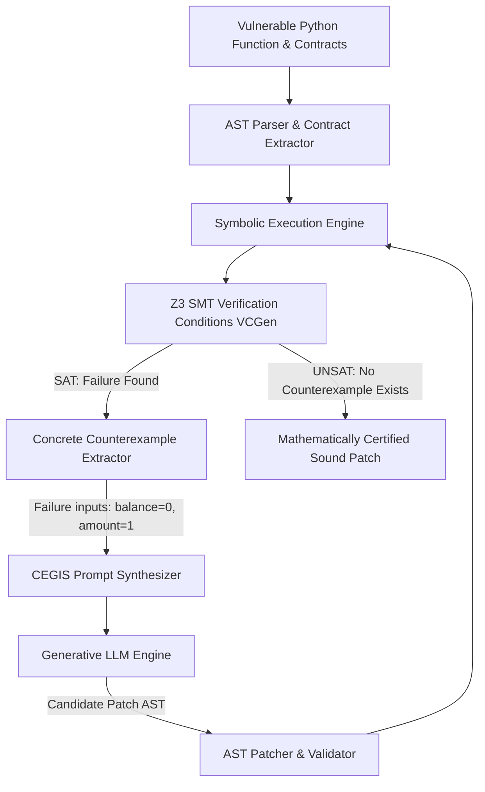
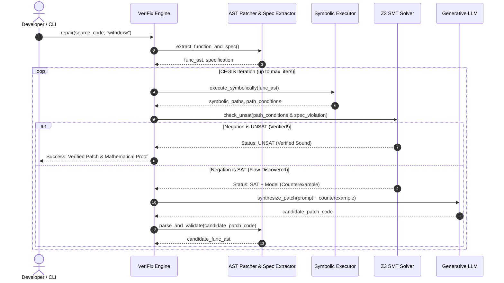

# VeriFix Architecture & Mathematical Foundation

VeriFix is a **neurosymbolic automated program repair framework**. It combines the creative, heuristic reasoning of generative Large Language Models (LLMs) with the mathematical rigor of Satisfiability Modulo Theories (SMT) theorem proving via the Microsoft Z3 engine.

---

## 1. The Neurosymbolic Paradigm

Traditional code generation often produces plausible-looking code with subtle flaws:
- **Heuristic synthesis (LLMs)** excels at semantic understanding and idiom recognition, but cannot guarantee soundness.
- **Deductive synthesis (SMT/Formal Methods)** guarantees absolute soundness across infinite state spaces, but struggles with unconstrained search and natural language idioms.

VeriFix unifies both via **Counterexample-Guided Inductive Synthesis (CEGIS)**:

---

## 2. Mathematical Formalization

### 2.1 Verification Condition Generation (VCGen)

Let a target function $f(\mathbf{x})$ have:
- Preconditions $\Phi_{\text{pre}}(\mathbf{x})$
- Postconditions $\Phi_{\text{post}}(\mathbf{x}, r)$ where $r = f(\mathbf{x})$
- Invariant safety properties $\Phi_{\text{safe}}(\mathbf{x})$ (e.g., non-zero divisors, valid indices, non-null dereferences)
- Execution path $\pi_i \in \Pi$, with path condition $\Phi_{\text{path}}^{(i)}(\mathbf{x})$ and symbolic return expression $E_i(\mathbf{x})$.

For any execution path $\pi_i$, a violation exists if there exists an input assignment $\mathbf{x}$ such that:

$$\Psi_{\text{bug}}^{(i)}(\mathbf{x}) \equiv \Phi_{\text{path}}^{(i)}(\mathbf{x}) \land \Phi_{\text{pre}}(\mathbf{x}) \land \neg \Big(\Phi_{\text{post}}\big(\mathbf{x}, E_i(\mathbf{x})\big) \land \Phi_{\text{safe}}^{(i)}(\mathbf{x})\Big)$$

We submit $\Psi_{\text{bug}}^{(i)}(\mathbf{x})$ to Z3:
1. **If SAT**: Z3 yields a satisfying assignment (model) $\mathcal{M}$. We extract $\mathbf{x}_{\text{cex}} = \mathcal{M}[\mathbf{x}]$, which represents a concrete bug trigger.
2. **If UNSAT**: No violating input exists for path $\pi_i$.
3. **If UNSAT for all paths $\pi_i \in \Pi$**: The function is mathematically proven correct with respect to its specification.

### 2.2 CEGIS Loop Termination

In each iteration $k$, the candidate patch $P_k$ is verified against $\Psi_{\text{bug}}$. If flawed, counterexample $\mathbf{x}_{\text{cex}}^{(k)}$ is accumulated into the constraint history:

$$\mathcal{H}_{k} = \mathcal{H}_{k-1} \cup \{ (\mathbf{x}_{\text{cex}}^{(k)}, \text{violation\_desc}) \}$$

The LLM prompt is conditioned on $\mathcal{H}_k$, ensuring subsequent candidate patches explicitly eliminate previously discovered counterexample subspaces.

---

## 3. Subsystem Breakdown

### 3.1 Contract Extractor (`verifix/core/contract.py`)
Parses and standardizes function contracts from multiple idioms:
- **Docstring tags**: `@requires condition`, `@ensures condition`
- **Function decorators**: `@requires("x > 0")`, `@ensures("return_val >= x")`
- **Native inline assertions**: `assert condition, "msg"`
- **Python type hints**: `int`, `Optional[T]`, `List[T]`

### 3.2 Symbolic Execution Engine (`verifix/verifier/symbolic_exec.py`)
Traverses the Python Abstract Syntax Tree (AST) in symbolic memory:
- **Path Condition Tracking**: Maintains conjunction of branch decisions (`If`, `Elif`, `Else`).
- **Bounded Loop Unrolling**: Dynamically unwinds loops (e.g., `range(k)`) up to configured symbolic depth bounds.
- **Expression Evaluation**: Translates Python AST binary operations, boolean logic, and subscripts into symbolic Z3 expressions.
- **Short-circuiting & Branch Pruning**: Prunes mathematically unreachable paths when path conditions become contradictory ($False$).

### 3.3 SMT Verifier (`verifix/verifier/smt_engine.py`)
Interfaces with the Microsoft Z3 SMT solver:
- Sort management: `Int`, `BitVec(32)`, `Bool`, `Array`.
- Automated translation of Python operators (`+`, `-`, `*`, `//`, `%`, `&`, `|`, `^`, `<<`, `>>`).
- Path-by-path condition solver with millisecond-precision timeouts.
- Concrete model reconstruction into Python-native primitives (`int`, `str`, `dict`).

### 3.4 Safety Rules Engine (`verifix/verifier/safety_rules.py`)
Active safety monitors verified on every symbolic node:
- **ZeroDivisionRule**: Ensures denominators $d \neq 0$ across integer and float divisions.
- **ArrayBoundsRule**: Enforces $0 \le \text{idx} < \text{len}$ for list indexing.
- **NoneDereferenceRule**: Validates optional/nullable variables are non-null prior to member access.
- **IntegerOverflowRule**: Guarantees signed 32-bit bounds ($-2^{31} \le x \le 2^{31}-1$) when enabled.

### 3.5 Generator & Prompt Synthesizer (`verifix/generator/`)
- **`prompt_builder.py`**: Builds structured instructions highlighting the vulnerable code, the exact contract, and the concrete counterexample values that triggered failure.
- **`gemini.py`**: Connects to the Google Gemini API for real-time neurosymbolic synthesis.
- **`mock_llm.py`**: Deterministic, offline repair provider implementing heuristic templates for offline environments and CI/CD testing.

### 3.6 AST Patcher (`verifix/patches/ast_patcher.py`)
- Ingests proposed code from the LLM.
- Validates syntax using `ast.parse`.
- Safely replaces the AST node of the target function while preserving surrounding code, imports, and docstrings.
- Performs non-regression checks.

---

## 4. Execution Sequence Diagram

---

## 5. Security & Trust Model

VeriFix enforces strict safety boundaries:
1. **Isolated AST transformations**: Code is never executed directly via `eval()` or `exec()` during verification; analysis is entirely symbolic.
2. **SMT Solver sandboxing**: Z3 runs in-process with strict resource limits and query timeouts to prevent ReDoS or infinite loops.
3. **Formal Soundness**: A patch is only certified if the Z3 solver mathematically confirms that no counterexample exists across all explored symbolic branches.
